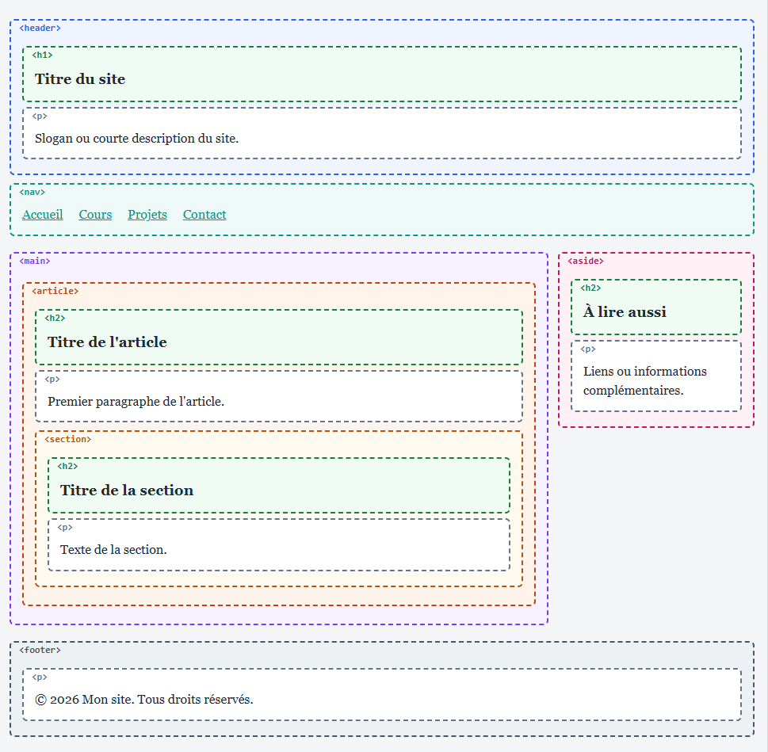

## **Voici la structure en schéma** :



---

## **Sens de chaque balise** :

```text
HTML      = HyperText Markup Language  → langage de balisage hypertexte (racine de la page)
HEAD      = head                       → en-tête invisible (titre de l'onglet, encodage, CSS)
BODY      = body                       → corps de la page : tout ce qui s'affiche
HEADER    = header                     → en-tête de la page (logo, titre du site)
NAV       = navigation                 → menu de navigation
MAIN      = main content               → contenu principal (un seul par page)
ARTICLE   = article                    → contenu autonome (billet de blog, actualité)
SECTION   = section                    → partie thématique d'un contenu, avec son titre
ASIDE     = aside                      → contenu secondaire (liens utiles, publicité)
FOOTER    = footer                     → pied de page (copyright, contact)
H1 --- H6 = heading                    → titres de niveau 1 à 6
P         = paragraph                  → paragraphe
DIV       = division                   → boîte générique, sans signification particulière
```

---

## **Quelques précisions** :

- `header` et `footer` peuvent aussi se trouver dans un `article` ou une `section`, pour leur propre en-tête ou pied.

- `div` n’a pas de sens propre : on l’utilise quand aucune balise sémantique ne convient, comme ici pour placer `main` et `aside` côte à côte.

- La mise en colonnes est faite en CSS avec `display: flex`, pas en HTML. Sur un petit écran (téléphone), les colonnes passent l’une sous l’autre.

- Il y a un seul `h1` par page, puis des `h2`, `h3`, etc. pour les sous-titres

---

- _**`index.html`**_ :

```html
<!DOCTYPE html>
<!-- DOCTYPE : indique au navigateur que c'est du HTML5 -->
<html lang="fr">
<!-- html : racine de la page, lang="fr" = langue du contenu -->

<head>
    <!-- head : informations invisibles (titre de l'onglet, encodage, CSS) -->
    <meta charset="UTF-8">
    <meta name="viewport" content="width=device-width, initial-scale=1">
    <title>Structure d'une page web</title>
    <!-- link : relie la page au fichier CSS externe (rel="stylesheet" = feuille de style, href = son adresse) -->
    <link rel="stylesheet" href="style.css">
</head>

<body>
    <!-- body : tout ce qui s'affiche dans la fenêtre du navigateur -->

    <header>
        <!-- header : en-tête de la page (logo, titre du site) -->
        <h1>Titre du site</h1>
        <p>Slogan ou courte description du site.</p>
    </header>

    <nav>
        <!-- nav : menu de navigation (liens principaux) -->
        <ul>
            <li><a href="#">Accueil</a></li>
            <li><a href="#">Cours</a></li>
            <li><a href="#">Projets</a></li>
            <li><a href="#">Contact</a></li>
        </ul>
    </nav>

    <div class="contenu">
        <!-- div : boîte générique, sans signification, ici pour mettre main et aside côte à côte -->

        <main>
            <!-- main : contenu principal, unique dans la page -->
            <article>
                <!-- article : contenu autonome (billet de blog, actualité) -->
                <h2>Titre de l'article</h2>
                <p>Premier paragraphe de l'article.</p>

                <section>
                    <!-- section : partie thématique d'un contenu, avec son titre -->
                    <h2>Titre de la section</h2>
                    <p>Texte de la section.</p>
                </section>
            </article>
        </main>

        <aside>
            <!-- aside : contenu secondaire (liens utiles, publicité, biographie) -->
            <h2>À lire aussi</h2>
            <p>Liens ou informations complémentaires.</p>
        </aside>
    </div>

    <footer>
        <!-- footer : pied de page (copyright, mentions légales, contact) -->
        <p>© 2026 Mon site. Tous droits réservés.</p>
    </footer>

</body>
</html>
```